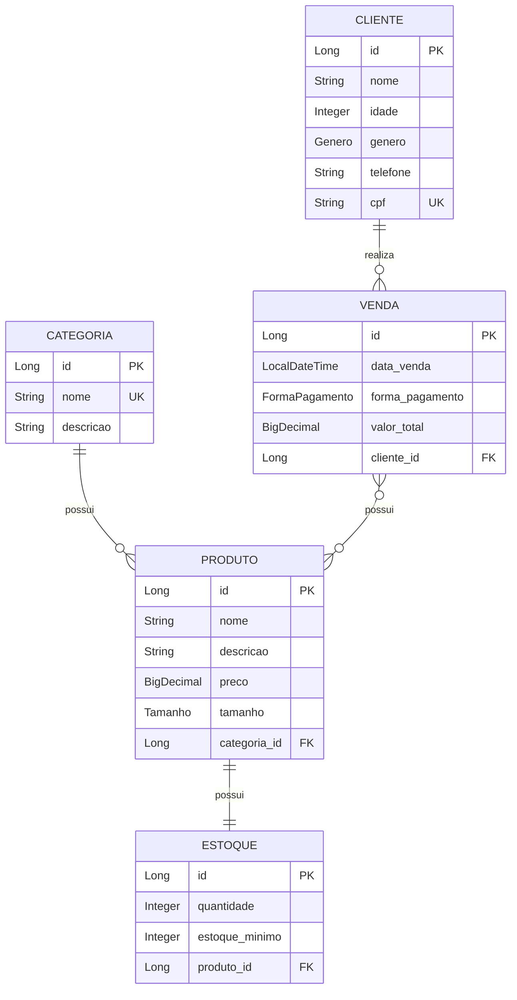

# Ponto de Vendas (PDV) API em Spring Boot

O PDV (Ponto de Vendas) é uma API REST desenvolvida em Spring Boot para gerenciamento de vendas, produtos e usuários. O sistema permite realizar vendas, controlar estoque de produtos e gerenciar usuários do sistema.

## Funcionalidades

* Gestão de Produtos: Cadastro, consulta, atualização e controle de estoque
* Gestão de Vendas: Criação de vendas com múltiplos itens
* Gestão de Usuários: Cadastro e controle de usuários do sistema
* Controle de Estoque: Atualização automática do estoque ao realizar vendas

---

### Core
* Java 17 - Linguagem de programação
* Spring Boot 4.1.1 - Framework principal
* Spring Data JPA - Persistência de dados
* Spring Web - Criação de aplicações web RESTful
* Bean Validation - Validação de dados
___
## Pré-requisitos
* Java 17 instalado
* Maven instalado (ou use o wrapper do projeto)

## Banco de Dados
* H2 Database - Banco em memória para desenvolvimento

## Ferramentas
* Apache Maven - Gerenciamento de dependências e build
* intelliJ IDEA - IDE recomendada
* Swagger
___

## Modelagem do Banco de Dados

O diagrama abaixo representa a estrutura de dados da API, incluindo os relacionamentos **One-to-One**, **One-to-Many** e **Many-to-Many**.


## Relacionamentos

| Entidades | Tipo | Descrição |
|---|---|---|
| `Cliente → Venda` | One-to-Many | Um cliente pode realizar várias vendas |
| `Categoria → Produto` | One-to-Many | Uma categoria pode possuir vários produtos |
| `Produto ↔ Estoque` | One-to-One | Cada produto possui um único estoque |
| `Venda ↔ Produto` | Many-to-Many | Uma venda pode possuir vários produtos e um produto pode participar de várias vendas |

## Legenda

| Sigla | Significado |
|---|---|
| `PK` | Primary Key |
| `FK` | Foreign Key |
| `UK` | Unique Key |
| `NOT NULL` | Campo obrigatório |
| `UNIQUE` | Valor único no banco |

## Endpoints da API

A API disponibiliza endpoints REST para gerenciamento de **Clientes, Categorias, Produtos, Estoques e Vendas**.

Todas as rotas que retornam coleções utilizam paginação através do `Pageable` do Spring Data.

Exemplo de paginação:

```http
GET /api/produtos?page=0&size=10&sort=nome,asc
```

---

## Cliente

**Base URL:** `/api/clientes`

| Método | Endpoint | Descrição | Status |
|---|---|---|---|
| `POST` | `/api/clientes` | Cadastrar um novo cliente | `201 Created` |
| `GET` | `/api/clientes` | Listar clientes com paginação | `200 OK` |
| `GET` | `/api/clientes/{id}` | Buscar cliente por ID | `200 OK` |
| `PUT` | `/api/clientes/{id}` | Atualizar um cliente | `200 OK` |
| `DELETE` | `/api/clientes/{id}` | Excluir um cliente | `204 No Content` |
| `GET` | `/api/clientes/cpf/{cpf}` | Buscar cliente pelo CPF | `200 OK` |

### Consulta personalizada

Busca um cliente através do CPF.

```http
GET /api/clientes/cpf/12345678900
```

---

## Categoria

**Base URL:** `/api/categorias`

| Método | Endpoint | Descrição | Status |
|---|---|---|---|
| `POST` | `/api/categorias` | Cadastrar uma nova categoria | `201 Created` |
| `GET` | `/api/categorias` | Listar categorias com paginação | `200 OK` |
| `GET` | `/api/categorias/{id}` | Buscar categoria por ID | `200 OK` |
| `PUT` | `/api/categorias/{id}` | Atualizar uma categoria | `200 OK` |
| `DELETE` | `/api/categorias/{id}` | Excluir uma categoria | `204 No Content` |
| `GET` | `/api/categorias/busca?nome={nome}` | Buscar categorias pelo nome | `200 OK` |

### Consulta personalizada

Busca categorias pelo nome.

```http
GET /api/categorias/busca?nome=camiseta&page=0&size=10
```

---

## Produto

**Base URL:** `/api/produtos`

| Método | Endpoint | Descrição | Status |
|---|---|---|---|
| `POST` | `/api/produtos` | Cadastrar um novo produto | `201 Created` |
| `GET` | `/api/produtos` | Listar produtos com paginação | `200 OK` |
| `GET` | `/api/produtos/{id}` | Buscar produto por ID | `200 OK` |
| `PUT` | `/api/produtos/{id}` | Atualizar um produto | `200 OK` |
| `DELETE` | `/api/produtos/{id}` | Excluir um produto | `204 No Content` |
| `GET` | `/api/produtos/busca?nome={nome}` | Buscar produtos pelo nome | `200 OK` |

### Consulta personalizada

Busca produtos que contenham determinado nome.

```http
GET /api/produtos/busca?nome=camiseta&page=0&size=10
```

---

## Estoque

**Base URL:** `/api/estoques`

| Método | Endpoint | Descrição | Status |
|---|---|---|---|
| `POST` | `/api/estoques` | Cadastrar um registro de estoque | `201 Created` |
| `GET` | `/api/estoques` | Listar estoques com paginação | `200 OK` |
| `GET` | `/api/estoques/{id}` | Buscar estoque por ID | `200 OK` |
| `PUT` | `/api/estoques/{id}` | Atualizar um estoque | `200 OK` |
| `DELETE` | `/api/estoques/{id}` | Excluir um estoque | `204 No Content` |
| `GET` | `/api/estoques/baixo` | Listar produtos com estoque baixo | `200 OK` |

### Consulta personalizada

Retorna os registros cuja quantidade disponível seja menor ou igual ao estoque mínimo.

```http
GET /api/estoques/baixo?page=0&size=10
```

Exemplo:

```text
quantidade = 3
estoque_minimo = 5

3 <= 5 → estoque baixo
```

---

## Venda

**Base URL:** `/api/vendas`

| Método | Endpoint | Descrição | Status |
|---|---|---|---|
| `POST` | `/api/vendas` | Registrar uma nova venda | `201 Created` |
| `GET` | `/api/vendas` | Listar vendas com paginação | `200 OK` |
| `GET` | `/api/vendas/{id}` | Buscar venda por ID | `200 OK` |
| `PUT` | `/api/vendas/{id}` | Atualizar uma venda | `200 OK` |
| `DELETE` | `/api/vendas/{id}` | Excluir uma venda | `204 No Content` |
| `GET` | `/api/vendas/cliente/{clienteId}` | Listar vendas realizadas por um cliente | `200 OK` |

### Consulta personalizada

Retorna todas as vendas realizadas por determinado cliente.

```http
GET /api/vendas/cliente/1?page=0&size=10
```

---

## Paginação

Todas as rotas que retornam listas utilizam paginação.

### Parâmetros

| Parâmetro | Descrição | Exemplo |
|---|---|---|
| `page` | Número da página | `0` |
| `size` | Quantidade de registros | `10` |
| `sort` | Campo e direção da ordenação | `nome,asc` |

### Exemplo

```http
GET /api/produtos?page=0&size=10&sort=nome,asc
```

---

## 🔗 HATEOAS

As respostas da API incluem links para navegação entre os recursos relacionados.

Exemplo de resposta:

```json
{
  "id": 1,
  "nome": "Camiseta Oversized",
  "descricao": "Camiseta preta",
  "preco": 89.90,
  "tamanho": "M",
  "_links": {
    "self": {
      "href": "/api/produtos/1"
    },
    "update": {
      "href": "/api/produtos/1"
    },
    "delete": {
      "href": "/api/produtos/1"
    },
    "estoque": {
      "href": "/api/estoques/produto/1"
    }
  }
}
```

---

## Códigos HTTP

| Código | Significado | Utilização |
|---|---|---|
| `200 OK` | Requisição realizada com sucesso | GET e PUT |
| `201 Created` | Recurso criado | POST |
| `204 No Content` | Operação concluída sem conteúdo | DELETE |
| `400 Bad Request` | Dados inválidos | Erros de validação |
| `404 Not Found` | Recurso não encontrado | ID inexistente |
| `409 Conflict` | Conflito de dados | CPF ou outro campo único duplicado |

---

## Resumo

| Entidade | CRUD | Consulta personalizada | Paginação |
|---|---|---|---|
| Cliente | ✅ | Buscar por CPF | ✅ |
| Categoria | ✅ | Buscar por nome | ✅ |
| Produto | ✅ | Buscar por nome | ✅ |
| Estoque | ✅ | Buscar estoque baixo | ✅ |
| Venda | ✅ | Buscar vendas por cliente | ✅ |

**Total: 30 endpoints REST**
