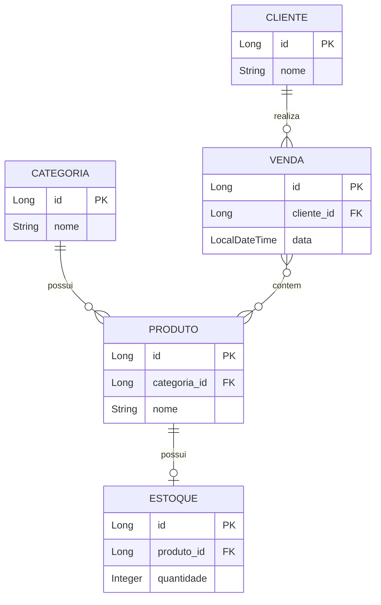

# VESTIPDV - API RESTFUL em Java com Spring Boot

API REST para lojas de roupas. O sistema mantém clientes, categorias, produtos, estoque e vendas; calcula o valor da venda no servidor e movimenta o estoque de forma transacional.


- **Status:** Concluído - Part I ✅
- **Status:** Andamento - Part II ✅

## Tecnologias

- Java 17 e Spring Boot 4.1.1
- Spring Web MVC, Spring Data JPA e H2
- Spring HATEOAS e Springdoc OpenAPI
- Jakarta Bean Validation e BCrypt para senhas
- Maven Wrapper


## Diagrama Entidade-Relacionamento (DER)

A API **VestiPDV** possui cinco entidades principais: `Cliente`, `Categoria`, `Produto`, `Estoque` e `Venda`.

### Modelo de Dados



### Relacionamentos

| Relação | Cardinalidade | Descrição |
|---------|---------------|-----------|
| Cliente → Venda | 1:N | Um cliente pode realizar várias vendas. |
| Categoria → Produto | 1:N | Uma categoria pode possuir vários produtos. |
| Produto → Estoque | 1:0..1 | Cada produto possui, no máximo, um registro de estoque. |
| Venda ↔ Produto | N:N | Uma venda pode conter vários produtos e um produto pode participar de várias vendas. |

### Regras de Negócio

- Cada venda está associada a um cliente.
- Cada produto pertence a uma categoria.
- Cada produto possui, no máximo, um saldo de estoque.
- Uma venda pode conter diferentes produtos.
- Cada produto representa uma unidade na venda.
- O relacionamento entre venda e produto não permite duplicidade do mesmo produto na mesma venda.

`Cliente.Genero`, `Produto.Tamanho` e `Venda.FormaPagamento` são enums persistidos como texto. As entradas passam por Bean Validation. As exclusões que violam referências recebem `409 Conflict`; uma venda devolve o estoque ao ser excluída.

> O modelo atual registra produtos distintos por venda. Para vender várias unidades do mesmo produto, o próximo passo de domínio seria uma entidade `ItemVenda` com quantidade — não enviar o mesmo produto repetido no JSON.

## Executar localmente

Pré-requisitos: JDK 17. O projeto traz o Maven Wrapper, portanto Maven global não é necessário.

```powershell
$env:MAVEN_OPTS='-Duser.home=C:\Users\jcaiq'
.\mvnw.cmd spring-boot:run
```

O banco H2 é em memória (`jdbc:h2:mem:testdb`) e criado/atualizado automaticamente. O console H2 está habilitado pela aplicação. Para executar os testes:

```powershell
$env:MAVEN_OPTS='-Duser.home=C:\Users\jcaiq'
.\mvnw.cmd '-Dmaven.repo.local=C:\Users\jcaiq\.m2\repository' test
```

## Swagger/OpenAPI

Com a aplicação em execução, abra [Swagger UI](http://localhost:8080/swagger-ui/index.html).

- V1: `http://localhost:8080/v3/api-docs/v1`
- V2: `http://localhost:8080/v3/api-docs/v2`

O seletor de grupos da interface permite alternar entre V1 e V2. Cada listagem aceita `page`, `size` (máximo 100) e `sort`, por exemplo:

```text
GET /api/produtos?page=0&size=10&sort=nome,asc
```

As respostas de recursos incluem `_links` HATEOAS, como `self`, `update`, `delete` e links para recursos relacionados.

## Versionamento

| Versão | Base | Cabeçalhos | Finalidade |
| --- | --- | --- | --- |
| V1 | `/api/**` | Nenhum obrigatório | Contrato legado preservado. |
| V2 | `/api/v2/**` | `X-API-Version: 2` | Contrato com API Key, rate limit e venda idempotente. |

Uma chamada à V2 sem `X-API-Version: 2` recebe `400 Bad Request`. A V1 não passa pela autenticação ou pelos limites da V2.

## V2: autenticação por API Key

No perfil local `dev`, a aplicação cria o usuário de demonstração `operador@pdv.com` com a senha `SenhaSegura123`. Isso serve somente ao desenvolvimento; em produção, use um perfil próprio e usuários reais com senhas BCrypt.

Faça login para emitir uma chave. A chave original é devolvida apenas nessa resposta, enquanto o banco armazena somente seu SHA-256.

```bash
curl -X POST http://localhost:8080/api/v2/auth/login \
  -H "Content-Type: application/json" \
  -H "X-API-Version: 2" \
  -d '{"email":"operador@pdv.com","senha":"SenhaSegura123"}'
```

Use o valor retornado em `apiKey` no botão **Authorize** do Swagger ou no header `X-API-Key`. Todos os endpoints V2, exceto o login, exigem a chave. Por padrão, a chave expira 24 horas após a emissão (`app.api-key.ttl-hours=24`).

```bash
curl http://localhost:8080/api/v2/produtos \
  -H "X-API-Version: 2" \
  -H "X-API-Key: SUA_API_KEY"
```

Revogue a própria chave com:

```bash
curl -X POST http://localhost:8080/api/v2/auth/logout \
  -H "X-API-Version: 2" \
  -H "X-API-Key: SUA_API_KEY"
```

## V2: venda idempotente

`POST /api/v2/vendas` exige `X-Idempotency-Key`. Use uma chave nova por intenção de venda, normalmente um UUID. A chave é associada ao usuário, à operação e a um fingerprint do corpo.

- Primeiro envio: cria a venda, baixa o estoque e responde `201`.
- Mesmo corpo e mesma chave: responde a resposta original com `Idempotent-Replayed: true`, sem uma nova baixa.
- Corpo diferente com a mesma chave: responde `409 Conflict`.
- Os registros de idempotência expiram em 24 horas por padrão (`app.idempotency.ttl-hours`).

Crie primeiro uma categoria, cliente, produto e estoque; então registre a venda:

```bash
curl -X POST http://localhost:8080/api/v2/vendas \
  -H "Content-Type: application/json" \
  -H "X-API-Version: 2" \
  -H "X-API-Key: SUA_API_KEY" \
  -H "X-Idempotency-Key: 1d8821c9-9b52-4c58-b714-bfa0c7a71dbd" \
  -d '{"formaPagamento":"PIX","cliente":{"id":1},"produtos":[{"id":1}]}'
```

## V2: rate limiting e CORS

O limite padrão é 60 requisições por minuto, por usuário autenticado (por IP no login). Ele é configurado em `application.properties`:

```properties
app.rate-limit.requests-per-minute=60
app.cors.allowed-origins=http://localhost:5173,http://localhost:3000
```

As respostas V2 expõem:

- `X-RateLimit-Limit`: máximo da janela
- `X-RateLimit-Remaining`: saldo de requisições
- `X-RateLimit-Reset`: timestamp Unix da próxima janela
- `Retry-After`: segundos até poder tentar novamente

Ao atingir o limite, a API retorna `429 Too Many Requests`. Os contadores são persistidos no banco; para um limite global estrito com múltiplas instâncias, configure banco compartilhado e coordenação distribuída adicional.

O CORS aceita apenas as origens configuradas por `app.cors.allowed-origins`, suporta preflight `OPTIONS` e permite `X-API-Version`, `X-API-Key` e `X-Idempotency-Key`. Ajuste a propriedade para as origens reais antes de publicar a API.

## Recursos REST

As rotas de cada versão cobrem criação, listagem paginada, consulta por ID, atualização e exclusão quando a integridade permite.

| Recurso | Consulta especializada |
| --- | --- |
| Clientes | `GET /api/clientes/cpf/{cpf}` |
| Categorias | `GET /api/categorias/busca?nome=...` |
| Produtos | `GET /api/produtos/busca?nome=...` |
| Estoques | `GET /api/estoques/baixo` e `GET /api/estoques/produto/{produtoId}` |
| Vendas | `GET /api/vendas/cliente/{clienteId}` |

Troque a base `/api` por `/api/v2` e envie os headers V2 para usar os recursos avançados.

## Respostas de erro

Erros usam `application/problem+json` com `status`, `title`, `detail`/`mensagem`, `timestamp` e `detalhes` de validação quando cabível.

| Status | Significado |
| --- | --- |
| 200 | Consulta ou atualização concluída. |
| 201 | Recurso criado. |
| 204 | Exclusão ou logout concluído. |
| 400 | Corpo, parâmetros ou versão inválidos. |
| 401 | API Key ausente, inválida ou revogada. |
| 404 | Recurso inexistente. |
| 409 | Integridade, estoque ou chave idempotente em conflito. |
| 429 | Limite de requisições excedido. |
| 500 | Falha interna sem detalhes sensíveis. |
